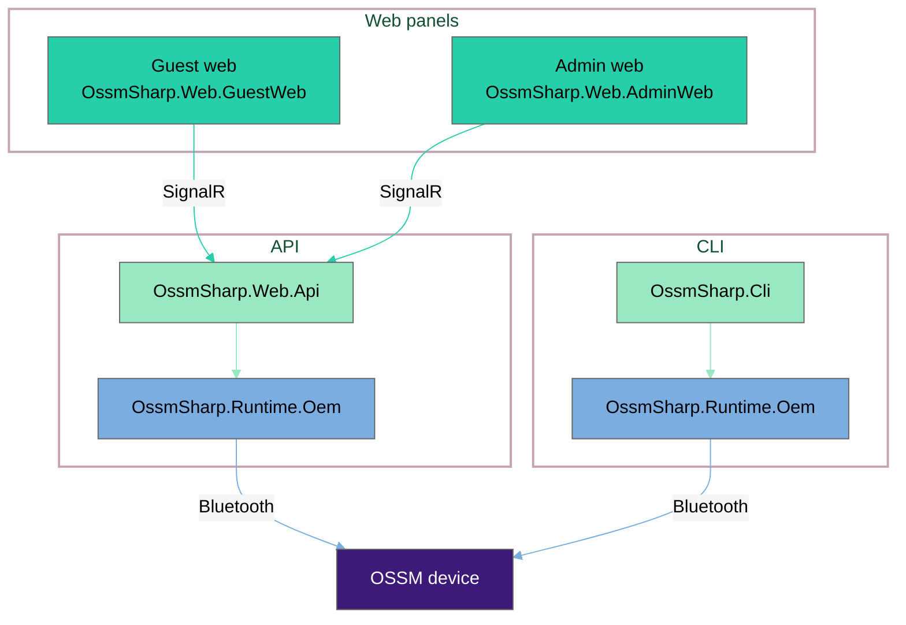
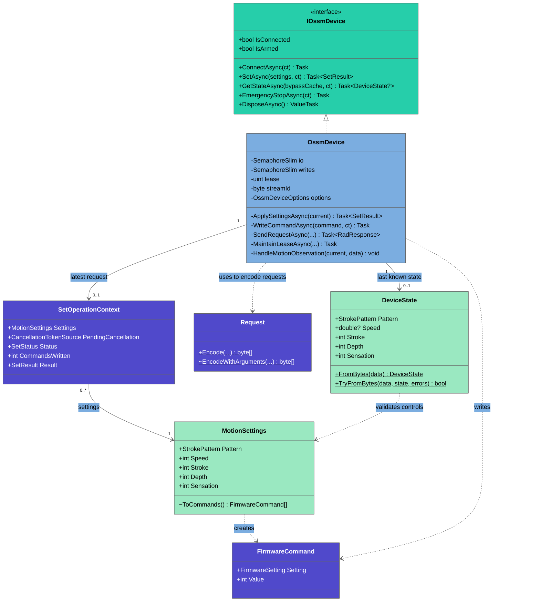

# Repository architecture

**Runtime** connects to the device over Bluetooth. **Web** provides browser
controls through a SignalR API. The CLI uses the same runtime.

## Runtime.Oem internals

The diagram abbreviates members and parameters. `ct` means `CancellationToken`;
`+`, `-`, and `~` mean public, private, and internal. Underlined methods are static.

[OssmDevice](../src/OssmSharp.Runtime.Oem/OssmDevice.cs) owns the connection,
lease, response matching, and motion stream. Its `io` gate serializes operations
except Stop. The `writes` gate serializes Bluetooth transfers, but releases
before waiting for a terminal response.

[MotionSettings](../src/OssmSharp.Runtime.Oem/MotionSettings.cs) checks basic
ranges, not pattern-specific rules, and converts speed to raw velocity:

`rawVelocity = floor(speedPercent * strokePercent / 100)`

At 10% stroke, 53% speed sends 5% raw velocity. Zero speed, zero stroke, or a
result below 1% sends zero. Depth and sensation do not affect the conversion.

[DeviceState](../src/OssmSharp.Runtime.Oem/DeviceState.cs) calculates current
speed as `100 * velocity / stroke` from one snapshot. It preserves decimals and
values above 100%; zero stroke gives unknown speed. Consumers use `Speed` without
converting it. These percentages are not physical speed or strokes per minute.
The firmware controls motion and safety.

Supporting types not in the diagram:

| Area      | Types and role                                                                                                                                                                                                                                                                            |
| --------- | ----------------------------------------------------------------------------------------------------------------------------------------------------------------------------------------------------------------------------------------------------------------------------------------- |
| Discovery | [DeviceDiscovery](../src/OssmSharp.Runtime.Oem/DeviceDiscovery.cs) and [IDeviceDiscovery](../src/OssmSharp.Runtime/IDeviceDiscovery.cs), using the Shiny Bluetooth library to scan for devices.                                                                                           |
| Protocol  | [BleLifecycleDelegate](../src/OssmSharp.Runtime.Oem/Protocol/BleLifecycleDelegate.cs) forwards peripheral lifecycle callbacks. [RadJsonContext](../src/OssmSharp.Runtime.Oem/Protocol/RadJsonContext.cs) supplies JSON metadata for protocol information, responses, leases, and streams. |
