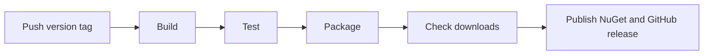

# Releasing

Push a stable version tag to build, test, and publish app downloads and the
NuGet package.

## Release pipeline



Defined in [release.yml](../.github/workflows/release.yml) and
[build.yml](../.github/workflows/build.yml). Publication uses the checked
artifacts, not a second build.

## Release a new version

1. Update `VersionPrefix` in [Directory.Build.props](../Directory.Build.props)
   and version examples. Merge with required checks passing.
2. Check Bluetooth permissions and device operation on Windows and macOS.
   Automated checks do not use hardware.
3. From clean, current `main`, push a tag matching `VersionPrefix` exactly.
   For `0.1.0`:

```sh
git switch main
git pull --ff-only
git tag -a v0.1.0 -m "OssmSharp 0.1.0"
git push origin v0.1.0
```

4. Monitor the Release workflow and approve the `release` environment if required.
5. Verify the public GitHub release, NuGet listing, and download checksums.

Use stable tags such as `v0.1.0`; prerelease tags are rejected.
Keep tagged source public for AGPL compliance. Protect `main` with the required
[Validate](../.github/workflows/validate.yml) checks and protect `v*` tags.

## NuGet trusted publishing

GitHub supplies an OIDC identity token. `NuGet/login` exchanges it for a
short-lived publishing key after NuGet checks the configured trust policy.
No long-lived NuGet API key is stored in GitHub.

One-time configuration:

1. Create the GitHub environment `release`, restricted to version tags.
2. Set repository variable `NUGET_USER` to the NuGet account username.
3. On nuget.org, create a policy for `OssmSharp.Runtime.Oem` with the repository
   owner/name, workflow filename `release.yml`, and environment `release`.

Follow [NuGet's trusted publishing guide](https://learn.microsoft.com/en-us/nuget/nuget-org/trusted-publishing)
for policy setup. The publication job already grants `id-token: write`.
The scripts currently target `argium/OssmSharp`; align that target and the policy
with the repository used for releases.

## Optional local checks

Use the SDK in [global.json](../global.json), PowerShell 7.4+, and Pester 6+.
Native builds need Windows x64 or Apple silicon with Xcode 27 and the .NET
macOS workload.

```powershell
pwsh -File ./.github/scripts/Build-Release.ps1
```

Outputs: `.artifacts/release/<runtime>/`.

## Recover

Fix the cause, then **rerun failed jobs** in the original run. Do not rebuild
successful native jobs: archives can differ even at the same commit.

Reuse original downloads. Artifacts expire after seven days; if originals are
unavailable, release a new version.

For manual recovery with credentials configured:

```powershell
./.github/scripts/Publish-Release.ps1 -Tag v0.1.0 -Directory .artifacts/release-input -WhatIf
./.github/scripts/Publish-Release.ps1 -Tag v0.1.0 -Directory .artifacts/release-input
```

Never move a public tag or replace published content. Use a new version.
Diagnose CI failures from run logs and artifacts; do not upload credentials,
payloads, or a full checkout.
