# Runtime internals

Implementation reference for `OssmSharp.Runtime.Oem`.
For installation and examples, see the
[library guide](https://github.com/OssmSharp/OssmSharp#readme).

## Components

| Component | Responsibility |
| --- | --- |
| `DeviceDiscovery` | Filter Bluetooth advertisements by the OSSM service UUID |
| `OssmDevice` | Own connection lifecycle, arming, requests, control lease, and subscriptions |
| `SetOperationContext` | Track one settings request, cancellation, status, and completed writes |
| `MotionSettings` | Validate basic ranges and produce ordered `FirmwareCommand` values |
| `Request` | Encode RAD BLE v1 requests |
| `DeviceState` | Parse motion observations and calculate current speed |
| `BleLifecycleDelegate` | Forward native peripheral lifecycle callbacks |
| `RadJsonContext` | Supply JSON metadata for protocol responses |

The firmware interprets patterns and controls motion. The runtime validates
basic ranges, not pattern-specific rules.

## Connection and arming

Connection phase and arming are separate fields. Arming gates settings requests;
it does not indicate physical motion or firmware readiness.

```mermaid
stateDiagram-v2
    [*] --> Disconnected
    Disconnected --> Connecting: ConnectAsync
    Connecting --> Armed: Setup and initial observation succeed
    Connecting --> Disconnected: Setup fails or is interrupted; cleanup
    state Connected {
        Armed --> Disarmed: Settings operation or Stop fails
        Disarmed --> Armed: ResetAsync
        Armed --> Armed: Successful Stop, cancellation, or readiness rejection
        Disarmed --> Disarmed: Successful Stop
    }
    Connected --> Disconnecting: Disconnect, connection failure, or lease loss
    Disconnecting --> Disconnected: Cleanup completes
    Disconnected --> Disposing: DisposeAsync
    Connecting --> Disposing: DisposeAsync
    Connected --> Disposing: DisposeAsync
    Disconnecting --> Disposing: DisposeAsync
    Disposing --> [*]: Cleanup settles; instance cannot be reused
```



The diagram omits failed-cleanup retries. `Disposing` is terminal even when
cleanup fails.

| Internal field / public property | Meaning |
| --- | --- |
| `phase` / `IsConnected` | `IsConnected` is true only in `ConnectionPhase.Connected` |
| `armed` / `IsArmed` | Permission to accept settings; no public disarm method |
| `active` | Protocol traffic remains possible during teardown until abandonment |
| `connectionCancellation` | Session identity and cancellation; rejects stale callbacks |
| `connection` | Lifecycle version; invalidates interrupted setup and queued rearming |
| `connectionFailure` / `ConnectionFailure` | Retained error; cleared by successful connection, not `ResetAsync` |
| `state` | Last valid observation; retained across disconnection |

Readiness rejection and caller cancellation do not disarm. A guard rejection
before any control write is treated as a readiness error. Other preparation
or write failures disarm. Connection loss also ends the connection.
Observations alone never change arming.

## API-to-protocol mapping

| API | Internal sequence | Firmware mode / arming |
| --- | --- | --- |
| `ConnectAsync` | Access check; peripheral ownership; protocol validation; subscriptions; lease acquisition; stream start; initial observation | Arms on success; sends no pattern settings |
| `SetAsync` | `PreparePatternAsync`; five ordered control writes | Requires armed connection and pattern readiness |
| `EmergencyStopAsync` | Cancel pending settings; priority `setting.write` to `motion.speed` with `0` | Success preserves arming; failure disarms |
| `ResetAsync` | Wait for `io`; validate lifecycle version; set `armed = true` | No firmware command or mode change |
| `ResetPositionAsync` | Streaming retract sequence below; Stop on exit | Requires armed connection; excludes settings and rearming |
| `GetStateAsync(false)` | Return `state` | No protocol request |
| `GetStateAsync(true)` | Wait for the next valid motion-stream observation | No mode change or separate snapshot stream |
| `DisconnectAsync` | Disarm; send or join Stop; stop stream; release lease; disconnect | Instance remains reusable |
| `DisposeAsync` | Disarm; cancel queued work; send or join Stop; release resources | Terminal; repeated calls share the result |

### Pattern readiness

Each settings request writes `setting.speedKnobAsLimit = false`.
Its response's `stateAfter` determines the next step:

| `stateAfter` | Action |
| --- | --- |
| `strokeEngine.idle`, `strokeEngine.pattern` | Write controls without re-entering the engine |
| `strokeEngine.preflight`, `strokeEngine.homing` | Reject as not ready |
| Other | Send `target.set` to `target.strokeEngine`; require idle or pattern state |

Control writes follow this order. Each uses `setting.write` and `args.value`.

| Order | `MotionSettings` property | `FirmwareSetting` | RAD path | Value |
| --- | --- | --- | --- | --- |
| 1 | `Pattern` | `Pattern` | `motion.pattern` | Defined enum ID, 0-6 |
| 2 | `Stroke` | `Stroke` | `motion.stroke` | Integer percentage, 0-100 |
| 3 | `Depth` | `Depth` | `motion.depth` | Integer percentage, 0-100 |
| 4 | `Sensation` | `Sensation` | `motion.sensation` | Integer percentage, 0-100 |
| 5 | `Speed`, `Stroke` | `Speed` | `motion.speed` | Calculated raw velocity, 0-100 |

These are separate requests, not an atomic transaction.
`SetResult.CommandsWritten` counts the five control writes only, not preparation.

### Position reset

`ResetPositionAsync` uses this fixed sequence:

1. Write zero raw velocity and `setting.speedKnobAsLimit = false`.
2. Select `target.streaming`; require `stateAfter == streaming.idle`.
3. Wait 100 ms. Write stroke, depth, and sensation at 100%, then raw velocity at 40%.
4. Send `target.set` to `motion.position` with `value = 100`, `durationMs = 5000`.
5. Read `motion.position` using `sensor.read` until a finite position equals 0 mm.
   Poll every 250 ms; there is no elapsed-time completion limit.
6. Send zero raw velocity and select `target.menu` on exit.

Previous settings are not restored. Stop, cancellation, disconnect, or disposal
interrupts the wait. Required Stop ignores caller cancellation. Retract failure
alone does not disarm; Stop failure or disconnection does.

## Speed calculation and state mapping

All control percentages use `50` for 50%, not `0.5`. They do not measure physical
speed or strokes per minute. Conversion occurs only inside this runtime.

```text
desiredDeviceVelocityPercent = floor(speedPercent * strokePercent / 100)
displayedSpeedPercent = 100 * currentDeviceVelocityPercent / currentDeviceStrokePercent
```

| Case | Result |
| --- | --- |
| Requested speed or stroke is zero | Send zero raw velocity |
| Calculated raw velocity is below 1% | Send zero |
| Requested speed 53%, stroke 10% | Send 5% raw velocity; current speed is 50% at that stroke |
| Observed stroke is zero | `DeviceState.Speed` is `null` |
| Observed velocity contains decimals | Preserve them in the calculation |
| Calculated current speed exceeds 100% | Preserve it without rounding or capping |

Depth and sensation do not affect conversion. Current speed uses velocity and
stroke from one observation, never pending settings.

| Observation JSON field | Storage / public property | Validation |
| --- | --- | --- |
| `pattern` | `DeviceState.Pattern` | Defined integer `StrokePattern` |
| `speed` | Internal `CurrentDeviceVelocityPercent`; calculated public `Speed` | Finite raw velocity, 0-100; decimals allowed |
| `stroke` | `DeviceState.Stroke` | Integer, 0-100 |
| `depth` | `DeviceState.Depth` | Integer, 0-100 |
| `sensation` | `DeviceState.Sensation` | Integer, 0-100 |

All five fields are required. Duplicate fields are rejected; unknown fields
are ignored. Standalone JSON parsing accepts 1-512 bytes with maximum depth 8.
Valid observations update the cache in arrival order. Changed controls raise
`StateChanged`; a live read receives the next valid observation.

## Request scheduling

| Mechanism | Scope |
| --- | --- |
| `sync` | Protect lifecycle, request tracking, and cached state |
| `io` | Serialize public operations except Stop |
| `writes` | Serialize issued GATT transfers; release before terminal-response waits |
| Supersession | New accepted settings cancel older work not yet sent |
| Stop priority | Queued traffic yields until the zero-velocity transfer settles |

Cancellation can end gate waits and response waits. It does not abandon an
issued GATT transfer. Concurrent Stop calls share one operation; joining callers
cannot cancel it. Settings and rearming are rejected while Stop is pending.

RAD requests use nonzero IDs. Responses match by ID; `accepted` is intermediate,
`completed` and `failed` are terminal. Response-timeout retries reuse the same
ID and payload. Defaults: three transmissions and two seconds per response wait.
Final timeout fails the connection.

## Bluetooth and lease

Service UUID: `522b443a-4f53-534d-0001-420badbabe69`.
Characteristic UUIDs replace its fourth group:

| Group | Use |
| --- | --- |
| `0002` | Read protocol information |
| `1000` | Write requests with response |
| `1100` | Subscribe to response indications |
| `2000` | Compact State; not used for motion controls |
| `2300` | Subscribe to motion-stream notifications |

`control.acquire` returns a nonzero token and positive lifetime. Renewal starts
at half the lifetime, measured from first transfer issuance. Lease loss fails
the connection; control is not reacquired automatically. Teardown joins renewal
before `control.release`.

One `stream.start` request on `motion.speed` selects the full motion surface.
Frames have a 20-byte header; the complete message is limited to 509 bytes.
The runtime checks version 1, stream ID, the JSON flag, and payload length.
Stale-stream frames are ignored. Malformed frames fail the connection; invalid
JSON observations are logged and discarded while waiting for the next sample.
